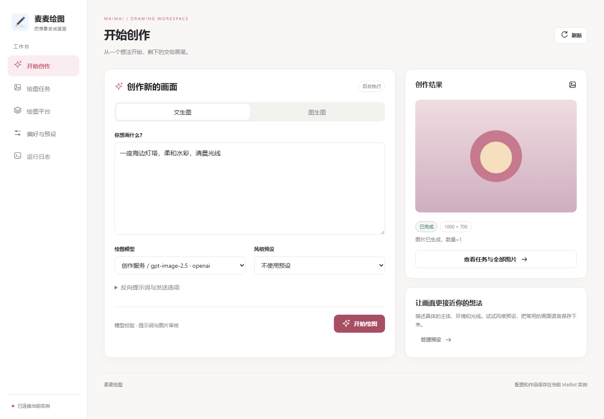
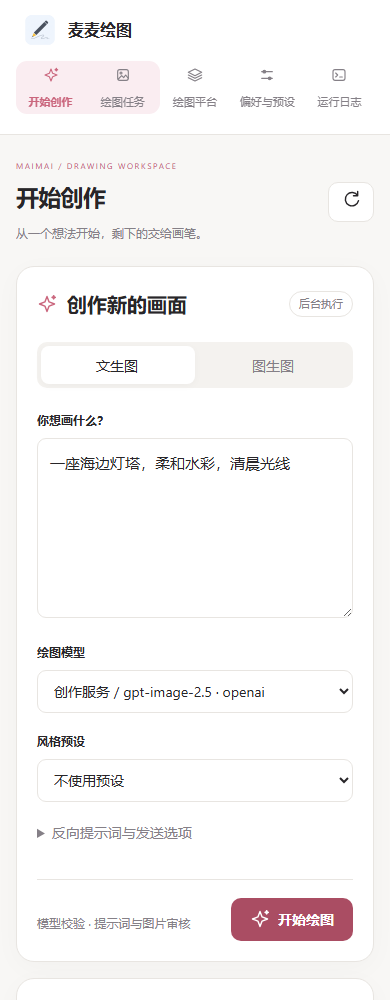

<div align="center">


# 麦麦绘图

   

让麦麦把想象变成画面：在聊天中绘图，也能在独立工作台配置平台、创作图片和管理任务。

</div>

- **聊天与工作台创作**：通过聊天命令或绘图工具发起任务，也可以在工作台输入提示词、上传参考图片，选择模型与风格。工作台默认只生成图片，需要回传聊天时再显式选择会话。
- **按需管理绘图平台**：只添加自己使用的平台，同类平台可以创建多个独立命名的实例，分别维护服务地址、密钥、模型和参数。模型首选项支持自动选择，备选模型按列表顺序使用。
- **集中查看任务与结果**：筛选任务、查看状态和失败原因，浏览预览图与原图，结合运行日志排查问题。长时间绘图在后台执行，可以离开创作页后继续查询。
- **可复用的偏好与风格**：在工作台维护通用参数、权限额度、审核和提示词模板；通用与风格草稿统一保存。其他可信插件也可以接入同一实例的任务服务，复用绘图能力。

## 工作台预览



桌面端并排呈现创作表单与结果；窄屏会调整为纵向布局，导航入口仍可直接访问。上图为当前页面使用示例配置与演示图片的界面预览，不代表特定模型的实际生成效果。

<details>
<summary>查看移动端预览</summary>



</details>

[安装](#安装) · [首次出图](#开始使用) · [平台配置](docs/platforms.md) · [常见问题](#常见问题) · [开发者接入](docs/integration.md)

## 安装

需要 **MaiBot ≥1.3.6、SDK ≥2.12.0、Python ≥3.12**，以及该 MaiBot 版本配套的官方 Dashboard。

### 体验本分支的工作台

当前工作台功能位于 **`feat/webui` 开发分支**，尚未合并。首次源码安装，在 MaiBot 目录执行：

```bash
cd plugins
git clone --branch feat/webui https://github.com/WhiteCloudOL/maimai-drawpic-plugin.git
```

重新加载插件或重启 MaiBot，在 WebUI 插件扩展页面打开“麦麦绘图”。已有安装请先备份并在原目录更新，避免安装两份同 ID 插件。[升级与恢复](docs/configuration.md#升级迁移与冲突恢复)。

### 从插件市场安装

插件市场使用其收录的发布版本，不能假定包含本开发分支的功能。[官方版本选择说明](https://github.com/Mai-with-u/plugin-repo/blob/main/VERSIONING.md)。

希望体验本文展示的工作台时，请使用上方明确选择分支的源码安装方式。已有安装不要重复克隆，应先备份数据，再更新原插件目录。

## 开始使用

首次使用前，准备好一个绘图服务账号及其 API Key，并确认账号已开通要使用的图片模型。ComfyUI 则需要可访问的服务和 API 格式工作流。

1. **添加平台。** 在扩展页面打开“麦麦绘图”，进入 **绘图平台 → 添加平台**，选择准备使用的平台类型。无需预先配置所有平台。
2. **填写连接信息和模型。** 设置不重复的**平台名称**，填写 API Key、服务地址和账号实际可用的模型，点击 **保存平台**。例如，同一服务的两个账号可以分别命名为“日常创作”和“备用账号”。保存后会出现平台卡片，已启用的模型会进入创作页的模型列表。
3. **完成第一次文生图。** 打开 **开始创作 → 文生图**，输入“一座海边灯塔，柔和水彩，清晨光线”，选择绘图模型，再点击 **开始绘图**。任务提交后会在后台执行，无需一直停留在当前页。
4. **查看进度和图片。** 在创作结果区域或 **绘图任务** 中查看状态；完成后打开任务详情，点击 **查看原图** 预览原文件。任务失败时先查看失败原因，再到 **运行日志** 筛选相关记录。

默认自动选择可用模型。新增 OpenAI 实例预填 `gpt-image-2.5`，**预填不代表账号已开通该模型**，请按实际权限修改。

需要图生图时，切换 **图生图**、上传真实源图片，并在提示词中说明希望保留和修改的内容。平台、模型的编辑能力与源图数量会在提交前校验；要求公网原图 URL 的模型不能直接使用网页上传的本地图片。

需要回传聊天时，展开创作表单中的发送选项，显式选择 **同时发送到聊天** 和已有会话；默认不会发送。更多操作见[完整使用指南](docs/usage.md)。

## 图片平台

| 平台 | 文生图 / 图生图 | 主要限制 |
| --- | --- | --- |
| OpenAI / 兼容服务 | 视模型支持 | RinkoAI NAI 暂不支持图生图 |
| Google Gemini | 视模型支持 | 参考图数量随模型变化 |
| 智谱 | 仅文生图 | 默认模型 `glm-image` |
| 阿里百炼 | 视模型支持 | 可灵/Vidu 编辑要求原图公网 URL |
| 火山引擎 | 视模型支持 | 按 Seedream 模型能力校验 |
| 硅基流动 | 视模型支持 | 生成、编辑模型可能分开 |
| NovelAI / NovelAPI | 支持 | 图生图仅一张源图 |
| ComfyUI | 依工作流支持 | 必须使用 API 格式工作流 |

所有平台都可添加多个命名实例；未添加的平台不启用。插件只处理图片，不会静默丢弃源图或改用另一种任务类型。[各平台最小配置与限制](docs/platforms.md)。

## 聊天命令

```text
/绘图 帮助
/绘图 模型
/绘图 文生图 夜晚的海边灯塔，水彩插画
/绘图 图生图 保留主体，把背景改成樱花树林
/绘图 风格 水彩 一座森林小屋
/绘图 状态
```

图生图需一起发送图片或回复带图片的消息；风格须先在工作台添加。也可以让麦麦通过绘图工具发起任务。[反向词、NAI 与完整命令](docs/usage.md#聊天命令)。

## 配置与数据

平台连接与模型在 **绘图平台** 管理，每个平台独立保存。审核、权限额度、模型偏好和风格模板在 **偏好与预设** 管理：右上角与刷新对齐的 **保存全部设置** 会一起保存“通用与审核”和“风格预设”，切换这两个分类会保留草稿。

风格模板中的 `{prompt}` 会替换为本次绘图描述，`{negative_prompt}` 会替换为本次反向提示词。保留占位符并在周围添加风格描述，就能反复套用同一风格；字段下方提供了具体示例。

插件开关、网络代理和缓存容量继续在 **MaiBot 插件配置页** 管理。图片缓存默认最多 **300 MB**，日志默认最多 **10 MB**，超限会自动清理；重要图片应在缓存过期前另行保存。配置存储位置、备份、迁移和恢复方法见[配置与数据指南](docs/configuration.md)。

### 权限、额度与审核

请在“偏好与预设 → 通用与审核”设置管理员、聊天额度和审核规则。[权限与审核说明](docs/configuration.md#权限额度与审核)。

## 常见问题

- **没有可选模型**：确认平台已启用、模型列表非空且名称与账号权限一致。
- **图生图被拒绝**：检查模型能力与参考图数量；要求公网源图 URL 的模型不能直接使用网页上传或联动 Base64 图片。
- **请求超时或结果待确认**：先查询原任务及提供商记录，避免立即提交新任务；取消本地等待不代表上游停费。
- **历史任务看不到图片**：缓存会按容量及保留期清理，重要作品请及时另外保存。
- **ComfyUI 找不到工作流**：确认 JSON 为 API 格式，并核对路径与节点 ID。[ComfyUI 配置](docs/platforms.md#comfyui-本地工作流)。
- **配置冲突或保存失败**：先保留备份，再按[恢复步骤](docs/configuration.md#升级迁移与冲突恢复)处理；多页面同时修改时可能需要刷新。

> 升级前备份配置和数据；迁移备份包含密钥。WebUI 仅向可信管理员开放，实例内 API 仅供可信插件使用。取消不保证上游撤单或停止收费。

## 完整文档

- 用户：[使用指南](docs/usage.md)、[平台配置](docs/platforms.md)、[配置与数据](docs/configuration.md)。
- 开发者：[插件联动](docs/integration.md)、[独立客户端](clients/README.md)。

## 插件联动

其他插件可通过实例内任务 API 与独立 `DrawingClient` 接入；参数、超时、幂等和代码示例见[开发者接入指南](docs/integration.md)。

问题反馈：[GitHub Issues](https://github.com/WhiteCloudOL/maimai-drawpic-plugin/issues)。许可证：[AGPL-3.0](LICENSE)。
